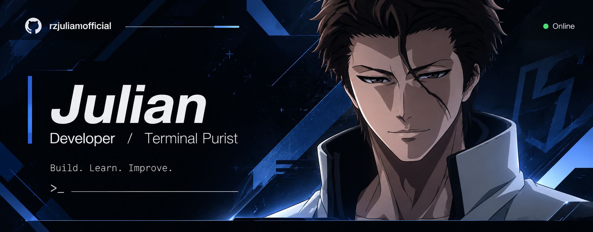

  

 

### <code> Biodata</code>

- 👤 **Full Name:** Nabhan Rizqi Julian Saputro (Julian)
- 📍 **Location:** Malang, East Java, Indonesia 🇮🇩
- 🎓 **Education:** D4 Informatics Engineering, Politeknik Negeri Malang (Polinema)
- 💻 **Role:** Applied AI &amp; Computer Vision · Full-Stack Software Engineer
- 🗣️ **Languages:** Indonesian (Native), English (Intermediate)

 

### <code> Focus</code>

- 🧠 **Computer Vision &amp; On-Device AI:** Deep learning model optimization (MobileNetV2, OpenCV) and TensorFlow Lite (TFLite) conversion for real-time on-device inference.
- 🌊 **Offline-First Architectures:** Marine catch analytics, fish morphometrics, and resilient edge-to-cloud data synchronization under zero-connectivity environments.
- 🛠️ **Full-Stack &amp; Mobile Engineering:** Robust system development using Laravel, Inertia.js (React), Flutter, Tailwind CSS, and PostgreSQL.

 

### <code> Tech Stack</code>

  

 

### <code> GitHub Stats  Streak</code>

  
  

 

### <code> Contribution Snake</code>

  <picture>
    <source media="(prefers-color-scheme: dark)" srcset="https://raw.githubusercontent.com/rzjuliannofficial/rzjuliannofficial/output/github-snake-dark.svg" />
    <source media="(prefers-color-scheme: light)" srcset="https://raw.githubusercontent.com/rzjuliannofficial/rzjuliannofficial/output/github-snake.svg" />
    
  </picture>

 

### <code> Commit  Contribution Activity</code>

  

 

---

  

    <em>“Intelligent code. Robust systems. Merging on-device Edge AI with resilient full-stack architectures.”</em>
  

  

    <em>“Code today, better tomorrow.”</em>
  

  

    🌐 <strong><a href="https://julian-portfolio-v1.vercel.app">Explore Portfolio Studio ↗</a></strong>
  

  

    
    
    
  

  © 2026 rzjuliannofficial · Build. Learn. Improve.

